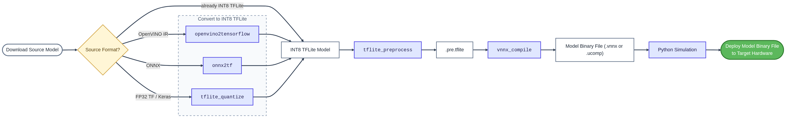

# Tutorials

This directory contains end-to-end tutorials that show how to generate a binary file for a specific model using the VectorBlox SDK. Tutorials are organized by model source. For a detailed breakdown of three of our tutorials, please refer to the [Tutorial Walkthrough Guide](../docs/tutorial_walkthrough_guide.md).

## Tutorials Overview

Each tutorial includes a shell script that demonstrates the complete pipeline:



1. Download the source model.
2. Convert the model to TensorFlow Lite (if needed) using one of the following: openvino2tensorflow, onnx2tf, or tflite_quantize.
3. Run `tflite_preprocess` to add a preprocessing layer before generating the binary.
4. Generate the binary with VectorBlox's graph generation tool: `vnnx_compile`.
5. Simulate and run inference using the Python script in `example/python` with the provided test image.

These scripts illustrate the complete pipeline for generating a model's binary file. Users may use or modify these scripts to generate a binary file for their own custom model, tailored to their use cases.

To run a tutorial script, change into the model's tutorial directory and run:

```bash
(vbx_env) ~/SDK/VectorBlox-SDK/tutorials/SOURCE_NAME/MODEL_NAME$ bash MODEL_NAME.sh
```

## Tutorial Metrics

- Runtime in milliseconds (ms) measured on [SoC Video Kit](https://github.com/Microchip-Vectorblox/VectorBlox-SoC-Video-Kit-Demo). Accuracy is measured over 1000 samples.
- **For a complete list of metrics for every VectorBlox tutorial, please visit the [Tutorial Metrics Appendix Markdown Page](../docs/tutorial_metrics_appendix.md) in the docs folder.**

## No Compression (subset)

| Source | Tutorial | Input<br>(H,W,C) | Runtime<br>(ms) | Task | Metric | TFLITE | VNNX |
|:---:|:---:|:---:|:---:|:---:|:---:|:---:|:---:|
| PINTO | [081_MiDaS_v2](PINTO/081_MiDaS_v2/081_MiDaS_v2.sh) | [256, 256, 3] | 122.564 | depth estimation | depthdelta1 (nyuv2) | 60.89 | 59.93 |
| onnx | [onnx_resnet18-v1](onnx/onnx_resnet18-v1/onnx_resnet18-v1.sh) | [224, 224, 3] | 25.982 |  | Top1 | 69.1 | 68.9 |
| openvino | [mobilenet-v1-1.0-224](openvino/mobilenet-v1-1.0-224/mobilenet-v1-1.0-224.sh) | [224, 224, 3] | 11.814 |  | Top1 | 70.1 | 70.1 |
| qualcomm | [FFNet-122NS-LowRes_512x288](qualcomm/FFNet-122NS-LowRes_512x288/FFNet-122NS-LowRes_512x288.sh) | [288, 512, 3] | 76.451 | segmentation | meanIoU (cityscapes) | 44.82 | 44.45 |
| qualcomm | [MobileNet-v3-Large-Quantized](qualcomm/MobileNet-v3-Large-Quantized/MobileNet-v3-Large-Quantized.sh) | [224, 224, 3] | 23.02 |  | Top1 | 69.6 | 68.8 |
| qualcomm | [QuickSRNetMedium-Quantized](qualcomm/QuickSRNetMedium-Quantized/QuickSRNetMedium-Quantized.sh) | [128, 128, 3] | 9.367 | image enhancement | PSNR (bsd300) | 26.79 | 26.81 |
| tensorflow | [mobilenet_v2](tensorflow/mobilenet_v2/mobilenet_v2.sh) | [224, 224, 3] | 13.085 |  | Top1 | 70.2 | 70.1 |
| ultralytics | [yolov8n](ultralytics/yolov8n/yolov8n.sh) | [640, 640, 3] | 55.727 | object detection | mAP⁵⁰⁻⁹⁵ | 37.4 | 37.38 |
| ultralytics | [yolov8n-cls](ultralytics/yolov8n-cls/yolov8n-cls.sh) | [224, 224, 3] | 4.24 | classification | Top1 | 67.2 | 67.3 |
| ultralytics | [yolov8n-obb](ultralytics/yolov8n-obb/yolov8n-obb.sh) | [1024, 1024, 3] | 146.691 | obb detection | mAP⁵⁰⁻⁹⁵ |  |  |
| ultralytics | [yolov8n-pose_512x288_split](ultralytics/yolov8n-pose_512x288_split/yolov8n-pose_512x288_split.sh) | [288, 512, 3] | 22.478 | pose detection | Pose Detection |  |  |
| ultralytics | [yolov8n-seg](ultralytics/yolov8n-seg/yolov8n-seg.sh) | [640, 640, 3] | 72.522 | instance segmentation |  |  |  |
| ultralytics | [yolov9t](ultralytics/yolov9t/yolov9t.sh) | [640, 640, 3] | 67.155 | object detection | mAP⁵⁰⁻⁹⁵ | 37.92 | 38.18 |


## Compression

| Source | Tutorial | Input<br>(H,W,C) | Runtime<br>(ms) | Task | Metric | TFLITE | VNNX |
|:---:|:---:|:---:|:---:|:---:|:---:|:---:|:---:|
| compressed | [yolov8m_comp69](compressed/yolov8m_comp69/yolov8m_comp69.sh) | [640, 640, 3] | 239.842 | object detection | mAP⁵⁰⁻⁹⁵ |  | 51.52 |
| compressed | [yolov8n_comp66](compressed/yolov8n_comp66/yolov8n_comp66.sh) | [640, 640, 3] | 37.053 | object detection | mAP⁵⁰⁻⁹⁵ | 37.18 | 37.3 |
| compressed | [yolov8s_comp68](compressed/yolov8s_comp68/yolov8s_comp68.sh) | [640, 640, 3] | 95.119 | object detection | mAP⁵⁰⁻⁹⁵ | 46.11 | 46.15 |
| compressed | [yolov9m_comp67](compressed/yolov9m_comp67/yolov9m_comp67.sh) | [640, 640, 3] | 322.171 | object detection | mAP⁵⁰⁻⁹⁵ |  |  |
| compressed | [yolov9s_comp68](compressed/yolov9s_comp68/yolov9s_comp68.sh) | [640, 640, 3] | 122.47 | object detection | mAP⁵⁰⁻⁹⁵ |  |  |
| compressed | [yolov9t_comp61](compressed/yolov9t_comp61/yolov9t_comp61.sh) | [640, 640, 3] | 55.879 | object detection | mAP⁵⁰⁻⁹⁵ |  |  |


## Unstructured Compression

| Source | Tutorial | Input<br>(H,W,C) | Runtime<br>(ms) | Task | Metric | TFLITE | UCOMP|
|:---:|:---:|:---:|:---:|:---:|:---:|:---:|:---:|
| unstructure_compressed | [resnet18_86s_07p](unstructure_compressed/resnet18_86s_07p/resnet18_86s_07p.sh) | [224, 224, 3] | 13.591 | classification | Top1 | 65.6 | 65.6 |
| unstructure_compressed | [yolov5n_70s_512x512](unstructure_compressed/yolov5n_70s_512x512/yolov5n_70s_512x512.sh) | [512, 512, 3] | 19.744 | object detection | mAP⁵⁰⁻⁹⁵ | 20.2 | 19.97 |
| unstructure_compressed | [yolov8n_50s_25p_512x288](unstructure_compressed/yolov8n_50s_25p_512x288/yolov8n_50s_25p_512x288.sh) | [288, 512, 3] | 15.474 | object detection | mAP⁵⁰⁻⁹⁵ | 34.6 |  |
| unstructure_compressed | [yolov8n_50s_25p_cut](unstructure_compressed/yolov8n_50s_25p_cut/yolov8n_50s_25p_cut.sh) | [640, 640, 3] | 48.049 | object detection | mAP⁵⁰⁻⁹⁵ | 36.7 | 36.64 |
| unstructure_compressed | [yolov8n_pose_50s_25p_512x288_split](unstructure_compressed/yolov8n_pose_50s_25p_512x288_split/yolov8n_pose_50s_25p_512x288_split.sh) | [288, 512, 3] | 15.406 | pose detection |  |  |  |
| unstructure_compressed | [yolov9s_70s_15p_512x288](unstructure_compressed/yolov9s_70s_15p_512x288/yolov9s_70s_15p_512x288.sh) | [288, 512, 3] | 34.463 | object detection | mAP⁵⁰⁻⁹⁵ | 43.2 |  |
| unstructure_compressed | [yolov9s_70s_15p_cut](unstructure_compressed/yolov9s_70s_15p_cut/yolov9s_70s_15p_cut.sh) | [640, 640, 3] | 98.857 | object detection | mAP⁵⁰⁻⁹⁵ | 45.8 | 45.48 |


## Legal

Microchip provides the VectorBlox Solution, including the IP, SDK and FPGA reference designs, solely
as tools for compiling, optimizing, deploying, or executing models selected by Customer. Microchip
does not review, approve, endorse, support, or stand behind any third-party or open-source
model, model weights, checkpoints, datasets, or related artifacts. You are solely responsible for
conducting appropriate diligence and testing regarding the security, provenance, authenticity, integrity,
licensing, compliance, and supply chain risks of any model you chooses to use or deploy from use of the
VectorBlox Solution. Microchip disclaims all liabilities and responsibility for vulnerabilities, malware,
backdoors, data poisoning, intellectual property or data privacy claims, or other supply chain risks.